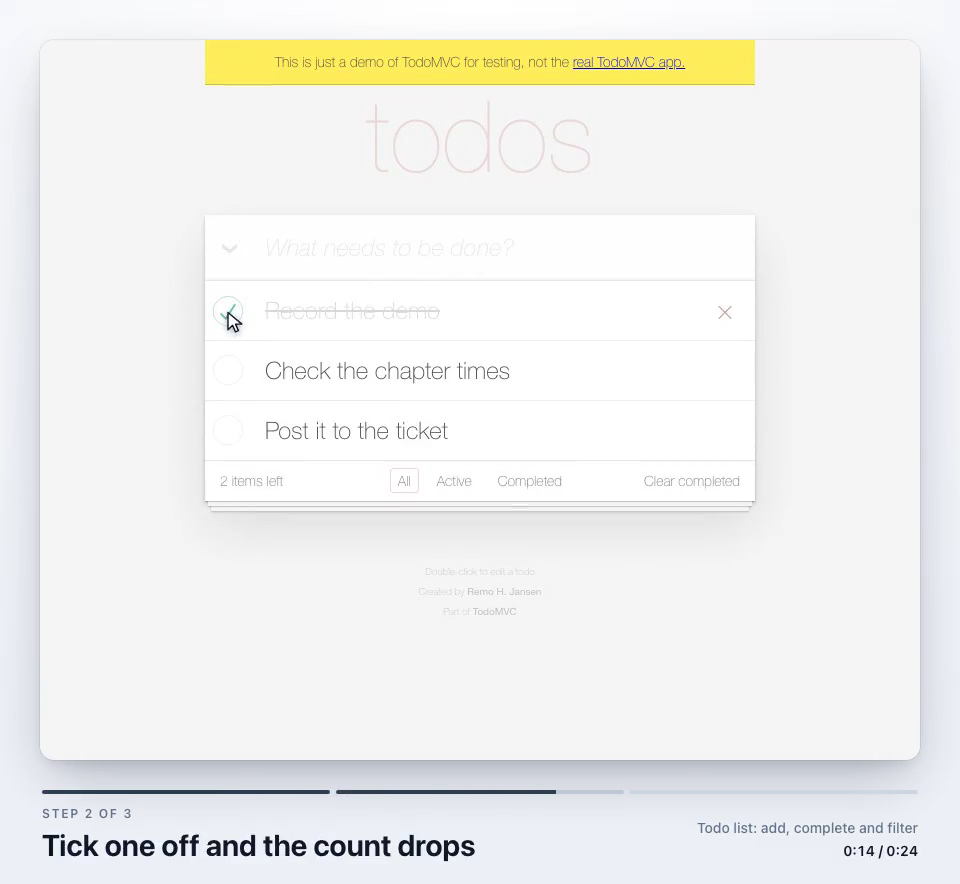

A finished feature used to wait for a demo meeting before QA saw it. The code was
done. The meeting was the queue.

`/demo` is my attempt to replace that meeting with a video on the ticket. It's the
newest skill in rmine-skills, my Claude Code plugin for Redmine. I give it a ticket
number. It reads the acceptance criteria and writes one scene per criterion, each with
a caption and a check that proves it. Then it drives the app running on my machine
through those scenes with Playwright, rehearses until every check passes, records one
take, and cuts the page loads out with ffmpeg. The video goes on the ticket as a single
comment with a chapter list (or one screenshot per scene, for a small feature), so PM
and QA can watch it when they have a minute and reply against a time: "at 1:30 the
empty state is wrong".

Nothing goes on the ticket until I've watched the video and said yes to the exact
comment it will post.

## Every scene ends on a check

A scene in the script looks like this:

```json
{
  "caption": "Filter the list by status",
  "start": "/items",
  "steps": [
    { "click": { "role": "button", "name": "Filters" } },
    { "select": { "label": "Status" }, "value": "Open" }
  ],
  "expect": [{ "visible": { "text": "3 results" } }, { "url": "status=open" }]
}
```

The `expect` list is the point of the whole thing. The reference the agent writes
scenes from puts it plainly: "the saved row shows Open" is a check, "the Save button
exists" is not.

If a check fails while recording, the run stops and there is no take to assemble.
Every run also deletes the previous take before it starts, so an old one can't be
assembled and posted by mistake. Put together, a video that reaches the ticket shows
each criterion passing.

There's a catch with letting an agent write both the steps and the checks. The
quickest way to a green run is to loosen the check. So the skill sorts failures into
two kinds. A wrong locator or a timing problem is a script fix, and the agent fixes
it and rehearses again. A feature that misbehaves is a finding: the agent stops and
tells me which scene failed and what was on screen, from a screenshot and the page's
accessibility tree saved at the moment it failed. The instruction for the second case
is one line, "Checks stay as strict as the criterion."

## The caption goes under the video

The first version drew captions inside the page, on top of the app, which is where
the thing being described usually is. The second put them in a dark band under the
video. Neither stayed.

What stuck is a frame. The take plays as a rounded window on a light canvas, and
underneath it sit the step number, a progress bar that fills as the scene plays, the
caption, the ticket's subject and the time. Nothing is drawn over the app except the
pointer, and that's a plain white arrow with a neutral ripple on each click. I tried
highlighting the target of every action too. It went the same way as the dark band.

This is a frame from a take it recorded on Playwright's public TodoMVC demo, halfway
through the second scene:



Assembly also writes a contact sheet: the last frame of every scene, side by side.
The review step reads it before the video. If a scene's final frame doesn't make its
criterion obvious, the scene needs a better ending, and that's much quicker to see in
one image than by scrubbing a video.

## One take, loading cut out

Each scene could start on a fresh page load. That's easier to script and worse to
watch, because every reload is time the viewer sits through. So scenes after the
first carry on from where the last one ended, and the agent orders them so each one
builds on the one before.

Some scenes still need a new page. The runner notes the wall-clock time when each
scene's page is ready and again when the scene ends, and assembly keeps only those
stretches, joined with ffmpeg's `trim` and `concat` filters.

Which raised the next problem. Wall-clock times are no use for chapters. The chapter
list needs to say where each scene starts in the video file.

## A black frame for time zero

My first approach counted back from the end. The take finishes at a moment I know, so
subtract. On a real app it came out up to a second late, which is enough for "1:30" to
land in the previous scene.

Now the runner opens every take on a black page, switches it to white after half a
second, and notes the time of the switch. Assembly reads the first ten seconds of the
recording with ffmpeg, takes the brightness of an 8x8 patch in the middle of each
frame, and finds the first white frame after a black one. That frame and the noted
time are the same instant, so every other mark converts directly:

```js
const times = marks.map((m) => Math.round((syncVideoSec + (m - syncWallMs) / 1000) * 100) / 100);
```

The same times go into the MP4 as chapter markers, so players that show chapters
show the scenes.

## It never failed on my Mac

On CI's Linux runners, recordings sometimes failed with `No sync frame found in the
recording`. Two of nine recording tests on the pull request's run, one on the run
after merge. All of them on Node 18, but two runs are too few to call that a pattern.

On my Mac, fifteen takes of the warm-up, with the CPU idle and with it saturated, all
caught ten to twelve black frames and then white. So the black was being recorded
here and something on Linux was losing either the black or the white. The error
message couldn't say which.

The tempting fix was a longer warm-up. I wrote in the issue that lengthening it
without evidence would only hide the cause, and recorded the warm-up in the
Playwright Linux image instead, printing how many black and white frames each take
caught. Three of five takes opened on white. The black was never recorded at all.

Playwright writes a video frame only when the browser sends one after a paint. The
black page was static, so the browser painted it once. On Linux that one paint often
happened before frames started flowing, so the video began on white and there was no
switch to find.

The fix is to keep the page painting. A one-pixel element in the corner alternates
between two shades of black on every animation frame, and the middle, where the check
reads, stays black:

```js
let n = 0; (function repaint() { tick.style.background = n++ % 2 ? "#010101" : "#020202";
requestAnimationFrame(repaint); })();
```

In that image, between one and seven of the 23 recording tests had been failing on
every run. After the change, five runs passed 23 of 23.

## Smaller things that took longer than they should have

**Waiting for a page.** Playwright's `load` event waits for every asset, and on a real
app it hung on third-party scripts. A page now counts as settled at
`domcontentloaded` plus network idle, and the network idle wait gives up after ten
seconds:

```js
await page.waitForLoadState('networkidle', { timeout: SETTLE_MS }).catch(() => {});
```

**Moving the pointer.** Moves used to be a fixed number of small steps. On a slow
canvas each step waited on the page, and a two-second drag took eighteen. Moves are
now timed by the clock: each one works out where the pointer should be from the time
elapsed, so a slow page skips positions instead of stretching the move.

**Scene order.** Watchers give the video a minute between other work, so the scene
that matters most goes first. The order comes from the ticket itself: the priority
the spec states, then what the customer asked for before what was added internally,
then the spec's own order, with risk breaking ties. Each scene's reason is written in
the scene list, so I can overrule it before anything is filmed.

**Size.** Redmine caps attachment size, and the cap varies by install, so `/demo` asks
for it once and assumes 5 MB if you don't know. The video is encoded at a fixed quality
first and only squeezed if it's over. If it would have to drop below 150 kbps to fit,
it stops and offers screenshots or two shorter videos instead.

A full dry run on a real ticket came out at five scenes, 47 seconds and 0.6 MB.

## What it doesn't do yet

Three things are on the roadmap, each as its own step:

- **Longer videos through Google Drive.** The attachment cap limits how long a demo can
  be. The plan is to copy the video into Drive's synced folder, share it with a group,
  and post the link instead. The Drive connector can't carry the upload, because it
  takes the file as base64 text inside one message, which is too big even for a short
  video.
- **A voice-over cut.** Plain footage is enough for PM and QA. A narrated version is for
  people who weren't in the conversation.
- **Recording against staging.** Right now it only records locally, because I sign in
  with my own local account in a browser window the skill opens, and the session is
  saved outside the repo where only I can read it. Staging needs a shared way to sign
  in that still keeps passwords out of the skill.

Title cards, zooms and music are left out on purpose.

The plugin is open source and MIT licensed:
[github.com/mehboobali98/rmine-skills](https://github.com/mehboobali98/rmine-skills).
